# Upstage_DUG_Room30
Upstage DUG AI Agent Hackathon - 30호 (2026.11)

## GradLens: 졸업요건 자동 사정

학과 조교와 학사 담당자용 졸업요건 2차 검증 웹앱.
졸업예정자 1명의 서류를 PDF 하나로 묶어 올리면 Upstage Studio 에이전트가 학과 시행세칙, 교육과정표, 대체과목 인정표와 대조해 **졸업 가능 / 확인 필요 / 졸업 요건 부족** 중 하나로 1차 판정함. 판정 이유와 빠진 서류, 판정에 쓰지 않은 서류까지 한 화면에 보여 주고 최종 판정은 담당자가 확인함.

워크플로우는 Upstage Studio에서 만들고, 담당자가 쓰는 화면과 중계 서버는 따로 만들어 Cloudflare Pages에 올렸음.

- 시연 영상: [assets/hackathon/demo.mp4](assets/hackathon/demo.mp4) (1분 47초)
- 발표자료: [assets/hackathon/presentation.pdf](assets/hackathon/presentation.pdf) (11쪽)
- 워크플로우 설정: [workflow/GradLens_workflow.json](workflow/GradLens_workflow.json) (Upstage Studio에서 내보낸 원본)
- 테스트 데이터셋: [workflow/dataset/](workflow/dataset/) (가상 학생 6명, 43쪽)과 정답지 [workflow/answer.json](workflow/answer.json)

[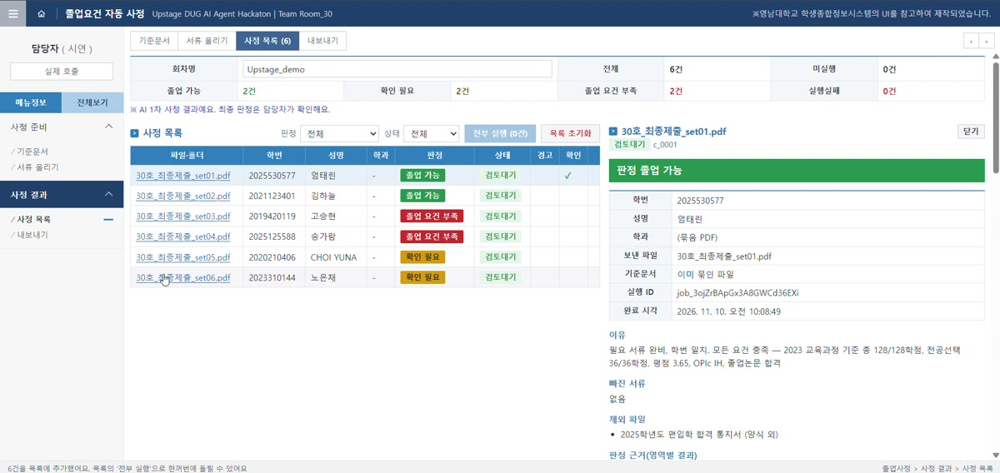](assets/hackathon/demo.mp4)

## 왜 만들었나

> "경로는 늘고, 기준은 문서에 있고, 확인은 사람이 합니다"

| 근거 | 내용 |
|---|---|
| 이수 경로가 다양해짐 | 2026학년도 전공자율선택제(무전공) 모집 41,299명(73개 대학, 전체의 11.9%). 입학연도와 선택 전공, 대체과목이 겹치며 예외가 늘어남 |
| 시스템 판정 뒤에도 사람이 봄 | 최종 졸업사정 뒤 학생이 결과를 확인하고 이의신청하는 기간은 3일. 졸업인증 누락이나 다전공 학점 오류를 이때 놓치면 졸업이 한 학기 밀림 |
| 기준 자체가 문서로 있음 | 시행세칙, 교육과정표, 대체과목표는 개편 때마다 HWP나 PDF 문서로 새로 나옴. 편입 학점인정, 어학, 졸업작품도 증빙 서류로 확인함 |

출처: KEDI Brief 제17호(2026.9), 뉴시스(2024.10.21), 국민대 경영대학 공지(2020.1.30). 자세한 내용은 [발표자료](assets/hackathon/presentation.pdf) 4쪽.

학사시스템 자가진단을 대신하려는 게 아니라 시스템이 못 보는 문서를 읽는 **2차 검증**이 목표임.

| 상황 | 학사시스템 자가진단 | GradLens |
|---|---|---|
| 교육과정 개편 직후 | 전산 반영이 늦음 | 새 기준문서를 올리면 바로 적용 |
| 폐지·명칭 변경 과목 | 규칙이 없으면 미이수 처리 | 대체과목표와 Match, 없으면 확인 필요 |
| 편입생 | 인정학점을 따로 처리 | 학점인정 확인서를 같이 읽어 합산 |
| 판정 이유 | "미충족"만 표시 | 부족 영역, 학점, 근거 문서를 문장으로 |

규칙은 코드가 아니라 문서에 있음. 그래서 규칙을 코드로 옮기지 않고 문서를 직접 읽는 워크플로우로 만들었음. 기준문서만 바꾸면 워크플로우를 고치지 않고 새 기준으로 판정함.

## 어떻게 푸나

**학생 한 명, 묶음 PDF 한 개 → 판정 JSON 한 개.**

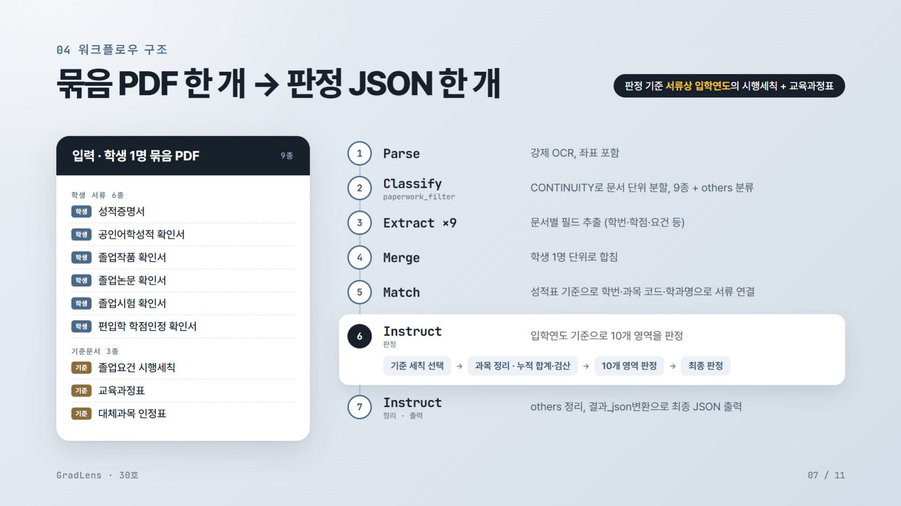

| 순서 | 노드 | 하는 일 | 고른 이유 |
|---|---|---|---|
| 1 | Parse | 묶음 PDF를 쪽 단위로 나누고 OCR(강제)로 글자와 표를 읽음 | 흐린 캡처, 그늘진 사진, 복사본이 섞인 이미지 PDF라 OCR 없이는 못 읽음 |
| 2 | Classify | 쪽마다 9종 + others(10가지) 중 하나로 분류하고 이어진 쪽은 한 문서로 묶음 | 문서마다 뽑을 값이 다름. 비슷하게 생긴 양식 외 문서를 여기서 걸러야 판정에 섞이지 않음 |
| 3 | Extract ×10 | 문서 종류별 스키마로 값 추출(성적표는 학번, 입학연도, 과목코드, 이수구분, 학점, 성적, 비고) | 스키마 하나로 다 뽑으면 빈 값과 오추출이 많아짐 |
| 4 | Merge | 추출 결과를 학생 1명 단위로 합침 | 판정에 성적표, 편입 인정학점, 세칙 기준이 함께 필요함 |
| 5 | Match | 성적표 학번으로 어학, 작품·논문·시험, 편입 서류를 잇고 과목코드로 교육과정표와 대체과목표를 이음. 학과명으로 시행세칙을 고름 | 다른 사람 서류나 성명 불일치를 판정 전에 잡음 |
| 6 | Instruct `판정` | 기준 정하기 → 과목 정리(누적 합계와 검산) → 10개 영역 판정 → 최종 판정 | 누적 계산, 조건 분기, 우선순위 판단은 다른 노드로 할 수 없음 |
| 7 | Instruct `결과_json변환` | 판정 결과를 키 6개 JSON으로 옮김. 판정은 다시 하지 않음 | 판정과 형식 맞추기를 나눠 숫자가 바뀌지 않게 함 |

### 다루는 문서

| 학생 제출 6종 | 학과 기준 3종 | others (판정에 안 씀) |
|---|---|---|
| 성적증명서(국문, 영문), 편입학 학점인정 확인서, 공인어학성적 확인서, 졸업작품 심사결과 확인서, 졸업논문 심사결과 확인서, 졸업시험 성적확인서 | 졸업요건 시행세칙, 교육과정표(2019, 2023), 대체과목 인정표 | 합격 통지서, 각종 신청서, 모의고사 성적표, 재학·졸업예정증명서 등 |

### 출력 (키 6개)

```json
{
  "student_id": "2019420119",
  "applicant_name": "고승현",
  "decision": "졸업 요건 부족",
  "reason": "어학 OPIc IL, 기준(IM1 이상) 미달. 나머지 요건(총 131/130학점·평점 3.20·졸업시험 합격(평균 69.3) 등)은 충족",
  "missing_documents": [],
  "excluded_files": [{ "file_name": "TOEIC 모의고사 성적표", "category": "양식 외" }]
}
```

| 키 | 내용 |
|---|---|
| `student_id` | 성적증명서의 학번(10자리) |
| `applicant_name` | 성적증명서에 적힌 성명 그대로. 영문 성적표면 영문 |
| `decision` | `졸업 가능`, `확인 필요`, `졸업 요건 부족` 중 하나 |
| `reason` | 판정 근거. 판정별 문장 틀이 정해져 있음 |
| `missing_documents` | 빠진 필수 서류 이름. 없으면 `[]` |
| `excluded_files` | others로 분류된 문서 `{file_name, category}`. 없으면 `[]` |

## 판정 규칙

**추측하지 않고, 이유를 남김.**

`판정` 노드가 10개 영역을 하나씩 충족, 확인 필요, 부족, 해당 없음 중 하나로 정한 뒤 최종 판정을 냄. 판정을 먼저 정해 놓고 숫자를 맞추지 못하게 [작업 1]~[작업 4]를 다 적은 다음 맨 끝에 판정하도록 프롬프트를 짰음.

| 영역 | 규칙 |
|---|---|
| 교양필수 | 적용 교육과정의 교양필수 전 과목 이수. 편입생은 해당 없음 |
| 교양선택 | 교선 합계 + 편입 인정 교양선택이 기준 이상 |
| 전공기초 | 지정 과목 전 과목 이수(편입 대응과목 포함). 기준이 0이면 해당 없음 |
| 전공필수 | 전 과목 이수. 대체과목표에 있는 대체 이수만 인정하고 이름만 비슷한 과목은 미이수 |
| 전공선택 | 확정 학점 A, 미확정 학점 B(타전공 인정 신청중, I 성적)로 나눠 A ≥ 기준이면 충족, A+B ≥ 기준이면 확인 필요 |
| 총학점 | 성적표 총 취득학점 ≥ 기준. 편입 인정학점은 세칙 한도까지만 |
| 평점 | 평점평균 ≥ 기준 |
| 어학 | 공인 시험(TOEIC, TOEIC Speaking, OPIc)만 인정. 기준 이상이고 유효기간이 졸업사정 기준일 이후. OPIc는 NL < NM < NH < IL < IM1 < IM2 < IM3 < IH < AL 순서로 비교 |
| 졸업인증 | 작품은 "통과" + 심사위원 전원 서명, 논문은 "합격"(조건부 합격은 확인 필요), 시험은 평균 60 이상 + 과목별 40 이상 |
| 서류 확인 | 성적표 학과와 세칙 학과가 다르거나 서류 간 성명이 다르면 확인 필요. 영문 성명은 로마자 표기로 비교 |

최종 판정은 아래 순서로 정함.

1. 빠진 서류가 하나라도 있으면 → 확인 필요
2. 부족이 하나라도 있으면 → 졸업 요건 부족
3. 부족은 없고 확인 필요가 있으면 → 확인 필요
4. 모두 충족이나 해당 없음이면 → 졸업 가능

| 예외 상황 | 처리 | 출력 |
|---|---|---|
| 누락, 불일치, 판독 불가 | 추측하지 않고 넘김. 빠진 서류와 다른 값은 기록 | 확인 필요 |
| 미확정, 조건부 | 확정된 값으로 계산하고 미확정까지 넣어야 충족되면 넘김 | 확인 필요 |
| 요건 미달 (예: 전공선택 33/36) | reason에 미달 요건과 실제 값, 기준 값을 적음 | 졸업 요건 부족 |
| 경계값 (예: 총학점 130/130) | 기준이 "이상"이라 같으면 통과 | 졸업 가능 |
| 동일인 불일치 (학번 같고 성명 다름) | 개명일 수 있어 같은 사람으로 단정하지 않고 두 성명을 reason에 적음 | 확인 필요 |
| 기준에 없는 문서 | others로 분류하고 그 안의 점수, 평점은 쓰지 않음 | excluded_files에 기록 |

## 데이터셋 (테스트 자료)

개인정보가 들어간 실제 서류는 쓰지 않고 가상대학교 학생 6명의 서류를 직접 만들었음. 학생마다 기준문서 3종까지 6~8쪽을 PDF 하나로 묶어 총 6세트 43쪽. 쪽마다 유형과 시험 목적, 기대 판정을 [유형표](workflow/dataset_types.xlsx)에 적었음.

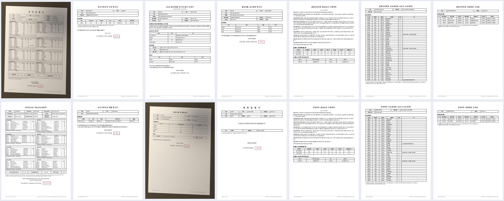

위는 set02(사진으로 찍은 성적증명서, 졸업작품 전시회 참가 신청서)와 set05(영문 성적증명서, 그늘진 졸업시험 확인서, 재학증명서).

| 유형 | 뜻 | 데이터셋에서 |
|---|---|---|
| ① 단순 | 양식이 깔끔하고 값이 맞는 기본 문서 | 시행세칙, 교육과정표, 대체과목표 대부분 |
| ② 양식·문맥 | 같은 업무지만 양식이나 표기가 다름 | 영문 성적증명서, 점수제 작품 결과표, 공문 형식 논문 통지 |
| ③ 결합 | 여러 문서가 한 파일에 섞임 | 6세트 전부 (학생 서류 + 기준문서 3종) |
| ④ 저품질 | 스캔, 촬영으로 읽기 어려움 | 사진 성적표, 흐린 캡처, 그늘진 사진, 복사본 |
| ⑤ 예외·함정 | 누락, 불일치, 닮은 서류 | 아래 표 |

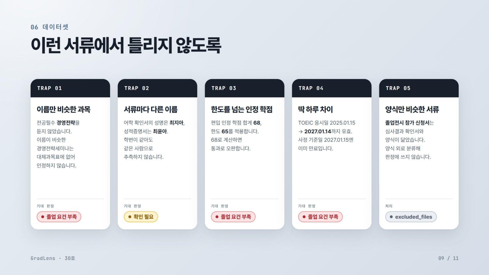

| 세트 | 학생 | 넣은 함정 | 정답 |
|---|---|---|---|
| set01 | 엄태린 | 편입생. 편입학 합격 통지서를 학점인정 확인서로 착각하지 않는지, 편입 65학점과 교양필수 면제 반영 | 졸업 가능 |
| set02 | 김하늘 | 사진 성적표에서 총학점 130/130 경계 읽기. 대체과목(CSE1001 → CSE1011) 적용. 전시회 참가 신청서는 작품 서류가 아님 | 졸업 가능 |
| set03 | 고승현 | OPIc IL < 기준 IM1 등급 비교. 기준을 넘는 교내 TOEIC 모의고사 점수는 쓰지 않음 | 졸업 요건 부족 |
| set04 | 송가람 | 맨 앞 졸업예정증명서를 성적표로 잡지 않음. 편입 인정 합계 68에 한도 65 적용 → 63 + 65 = 128 < 130 | 졸업 요건 부족 |
| set05 | 최윤아 | 영문 성적표(CHOI YUNA)와 어학 확인서(최지아) 성명이 다름. 학번이 같아도 같은 사람으로 단정하지 않음 | 확인 필요 |
| set06 | 노은채 | 졸업논문 조건부 합격, 재제출 기한이 기준일 이후. 장학금 신청서의 평점은 성적으로 쓰지 않음 | 확인 필요 |

### 결과

시연 영상에서 6세트를 한 번에 돌린 결과 **6건 모두 정답지와 판정이 같았음**(졸업 가능 2, 졸업 요건 부족 2, 확인 필요 2). set01과 set03은 함정으로 넣은 양식 외 서류도 excluded_files로 정확히 빠졌음.

## 화면

담당자 화면은 영남대학교 학생종합정보시스템 UI를 참고해 조교에게 익숙한 모양으로 만들었음. 아래는 모두 시연 영상 캡처.

### 1. 올리고 실행

| 서류 올리기 |
|:---:|
| 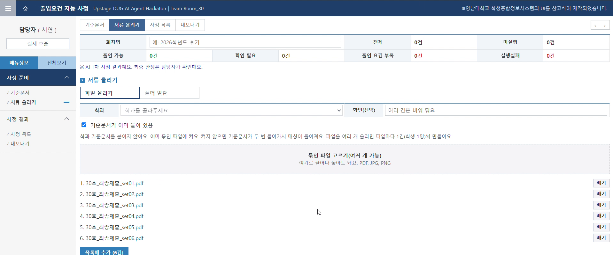 |
| 파일 올리기와 폴더 일괄 두 가지. 기준문서가 이미 들어 있는 묶음 PDF면 파일마다 1건(학생 1명)으로 만듦 |

| 실행 중 |
|:---:|
| 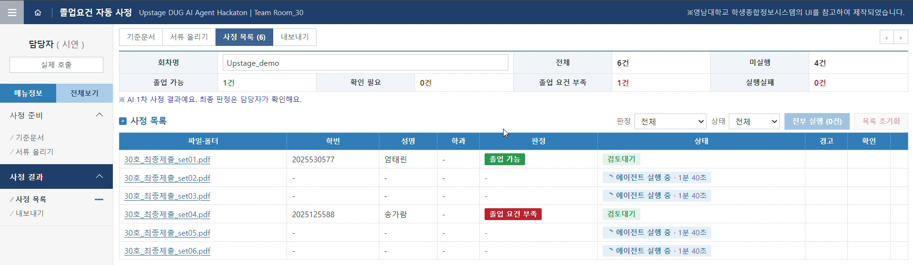 |
| 건마다 따로 올리고 실행해서 끝난 건부터 판정이 뜸. 단계(올리는 중, 실행 요청 중, 에이전트 실행 중)와 경과 시간을 보여 줌 |

### 2. 결과 보기

| 사정 목록과 상세 |
|:---:|
| 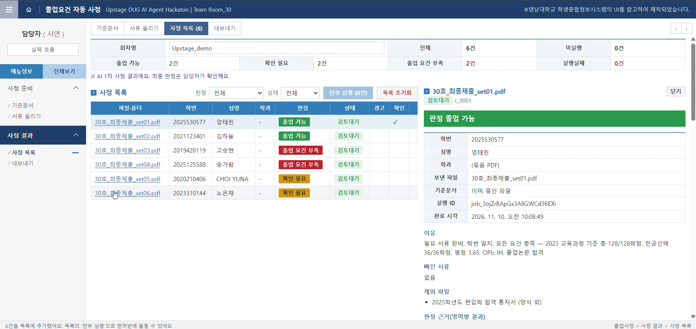 |
| 위쪽에 판정별 건수. 건을 누르면 오른쪽에 판정, 이유, 빠진 서류, 제외 파일. 담당자가 확인함 표시와 메모를 남김 |

| 판정 근거 (영역별 결과) | 함정 서류 제외 |
|:---:|:---:|
| 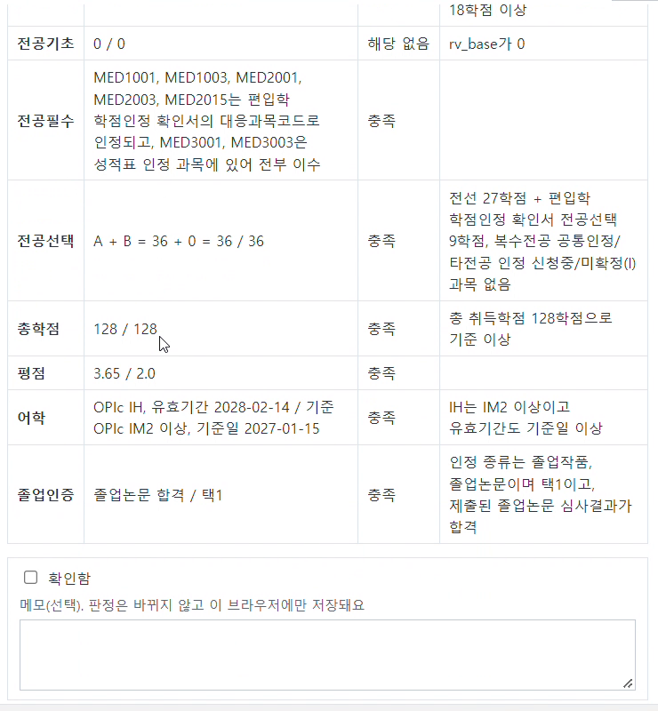 | 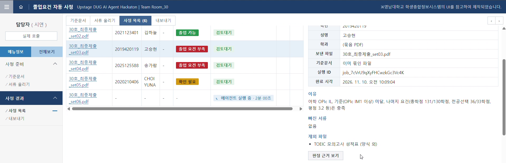 |
| `판정` 노드의 [작업 3] 10줄을 표로 바꿔 보여 줌. 영역마다 이수/기준, 결과, 이유 | set03. TOEIC 모의고사 성적표는 양식 외로 빠지고 OPIc IL 미달로 졸업 요건 부족 |

### 3. 내보내기

| 내보내기 | 결과 PDF |
|:---:|:---:|
| 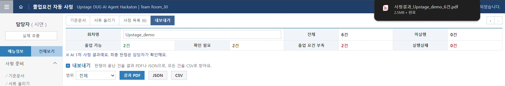 | 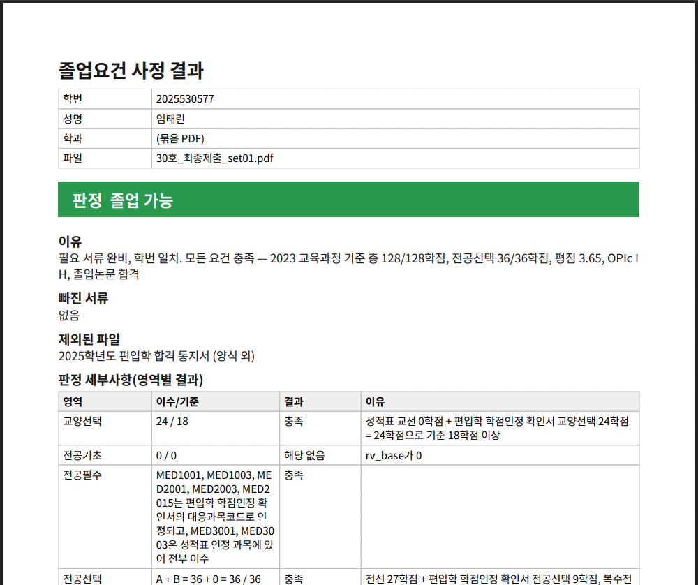 |
| 판정이 끝난 건을 결과 PDF와 정답지 형식 JSON으로, 모든 건을 CSV로 받음. 전체 또는 거른 목록만 | 요약 1쪽 + 학생별 1쪽. 학생별 쪽에 판정 세부사항 표가 들어감 |

## 사용 흐름

- **준비**: 기준문서 화면에서 학과별 시행세칙, 교육과정표(연도별), 대체과목 인정표를 등록. 3종이 다 있어야 그 학과로 실행함
- **올리기**: 학생 1명 파일들을 올리거나, `학과/학번_이름/파일` 모양 폴더를 통째로 올림. 브라우저가 학생 서류와 기준문서를 PDF 하나로 묶음
- **실행**: 전부 실행. 건마다 Upstage에 올리고 에이전트를 돌린 뒤 5초마다 상태를 확인함
- **확인**: 판정과 이유, 판정 근거 표를 보고 담당자가 확인함 표시. 메모는 판정을 바꾸지 않음
- **내보내기**: 결과 PDF, JSON, CSV

## 주요 기능

**올리기와 묶음 PDF**

- PDF, JPG, PNG만 받음. 이미지는 다시 압축하지 않고 A4 쪽에 맞춰 넣음.
- 묶을 때 쪽 지도(몇 쪽이 어느 파일의 몇 쪽인지)를 같이 만듦. 제외 파일에 "(3쪽)"처럼 쪽 번호가 오면 눌러서 미리보기를 그 쪽으로 옮김.
- 폴더 일괄은 경로에서 학과, 학번(10자리), 이름을 읽음. 학생 폴더 안 `기준문서/` 폴더는 그 학생에게 딸린 기준문서로 봄. macOS가 한글 경로를 NFD로 줘서 NFC로 맞춘 뒤 비교함.
- 기준문서 순서는 시행세칙 → 교육과정표(연도순) → 대체과목 인정표로 고정함. 폴더에서는 이름순으로 와서 따로 정렬함.
- 암호가 걸렸거나 깨진 PDF는 실행 전에 검증실패로 막음.

**실행과 복구**

- 사정 건은 브라우저(localStorage)에 저장함. 실행 중에 탭을 닫아도 다시 열면 job id로 이어서 확인함.
- 한꺼번에 여러 건을 보내면 Upstage가 일부를 잠깐 거절함(429). Retry-After가 오면 그만큼, 없으면 10초 → 20초 → 40초 → 60초에 0~5초를 더해 건마다 엇갈리게 다시 보냄(최대 5번).
- 업로드한 파일이 아직 처리 중이라 실행 요청이 409로 오면 10초 뒤 다시 보냄.
- 20분이 넘으면 시간 초과로 멈춤. 끝나면 성공이든 실패든 Upstage에 올린 파일을 지움.

**결과 검증**

- 에이전트 결과를 다시 계산하지 않고 그대로 보여 줌. 대신 형식은 검사함.
- 오류: 키 6개가 다 있는지, decision이 세 값 중 하나인지, 두 목록이 배열인지. 틀리면 실행실패로 두고 원문을 보여 줌.
- 경고: 학번이 10자리 숫자가 아님, 빠진 서류가 있는데 확인 필요가 아님, 올릴 때 적은 학번과 결과 학번이 다름.

**내보내기**

- 결과 PDF는 pdf-lib로 브라우저에서 만듦. Noto Sans KR을 넣어 한글이 깨지지 않음.
- 판정 근거를 아직 안 받은 건은 PDF를 만들기 전에 먼저 받아 넣음. 못 받은 건은 세부사항 없이 만들고 몇 건인지 알려 줌.
- CSV는 엑셀에서 한글이 깨지지 않게 UTF-8 BOM을 붙임. `=`, `+`, `-`, `@`로 시작하는 값은 앞에 `'`를 붙여 수식으로 실행되지 않게 함.

## 기술

### 구조

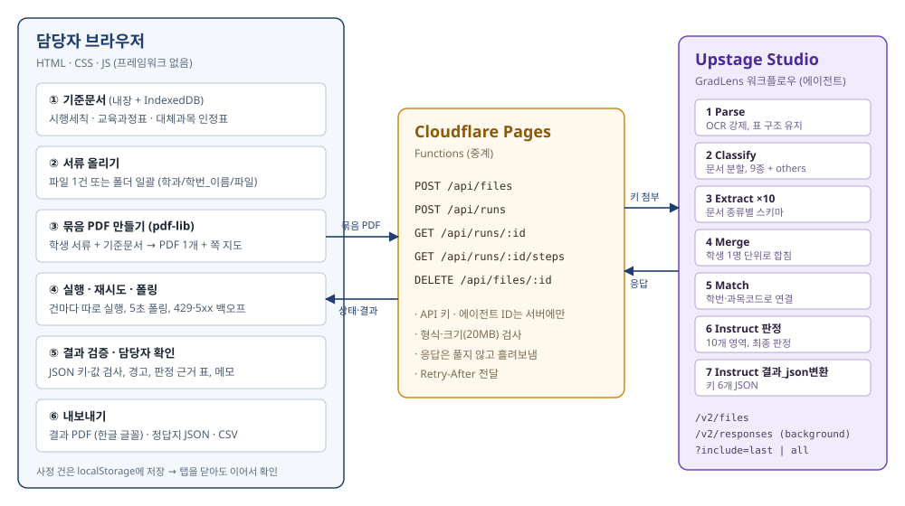

화면은 정적 파일이고 서버는 Cloudflare Pages Functions 5개가 전부임. 서버는 API 키를 붙여 Upstage에 중계만 하고 판정 로직은 Upstage Studio 워크플로우에 있음.

### 기술 선택과 이유

| 기술 | 고른 이유 | 한계 |
|---|---|---|
| Upstage Studio 워크플로우 | Parse, Classify, Extract, Match를 노드로 이어 붙이고 판정 규칙은 프롬프트로 적음. 기준이 바뀌어도 코드를 다시 배포하지 않음 | 판정 품질이 프롬프트와 추출 정확도에 달림. 실행 1건에 몇 분 걸림 |
| HTML, CSS, JS (프레임워크 없음) | 빌드 없이 바로 배포. 화면이 표 위주라 프레임워크가 필요 없었음 | app.js 한 파일이 1,000줄 가까이 됨 |
| pdf-lib (브라우저) | 묶음 PDF와 결과 PDF를 서버 없이 브라우저에서 만듦. 학생 서류가 중계 서버에 남지 않음 | 한글 OTF 글꼴은 pdf-lib 자체 서브셋이 깨져서 미리 줄인 글꼴을 통째로 넣음 |
| Cloudflare Pages Functions | API 키를 화면에 두지 않으려고 중계만 서버로 뺌. 무료 플랜으로 충분 | 무료 플랜 CPU 10ms 제한. 응답을 풀지 않고 그대로 흘려보내서 맞춤 |
| localStorage + IndexedDB | 로그인과 DB 없이 담당자 한 명이 쓰는 도구로 범위를 줄임. 사정 건은 localStorage, 기준문서 PDF는 IndexedDB | 브라우저를 바꾸면 기록이 없음. 여러 담당자가 나눠 쓰지 못함 |

### 핵심 구현

- **API 키 보호**: `UPSTAGE_API_KEY`와 에이전트 ID는 서버 환경변수에만 둠. 어떤 에이전트를 돌릴지 브라우저가 고르지 못함. file id와 job id는 정규식으로 형식을 검사한 뒤에만 Upstage로 넘김.
- **x-project-id 누락 막기**: 프로젝트 안 에이전트라 모든 요청에 `x-project-id`가 필요함. 빠지면 업로드는 되고 실행만 403(No access to file)이 나서 원인을 찾기 어려웠음. 그래서 환경변수 3개 중 하나라도 없으면 호출 전에 `E-CONFIG`로 막음.
- **응답 크기 줄이기**: 상태 확인은 `include=last`로 마지막 노드 글만 받고, 판정 근거는 담당자가 누를 때만 `include=all`로 받음.
- **에이전트 출력 정리**: Upstage 응답 글은 JSON 문자열로 한 번 더 감싸여 오고 `【†37】` 같은 인용 표시가 붙음. 인용 표시가 닫는 따옴표 뒤에 붙으면 `JSON.parse`가 실패해 판정 근거가 한 줄로 뭉쳤음. 인용 표시를 먼저 떼고 겉 문자열을 벗긴 뒤 읽음.
- **판정 근거 표**: 노드 이름(`Instruct - 판정`)으로 판정 노드를 찾고, 이름이 바뀌었으면 내용([작업 3], "판정:")으로 찾음. "영역: 이수/기준 - 결과 (이유)" 줄을 표로 바꾸고 형식이 안 맞으면 원문을 그대로 보여 줌.

### 쓴 기술

- 워크플로우: Upstage Studio (Document Parse, Classify, Information Extract, Merge, Match, Instruct)
- 화면: HTML, CSS, JavaScript (ES 모듈, 프레임워크 없음), pdf-lib, @pdf-lib/fontkit, Noto Sans KR
- 서버: Cloudflare Pages Functions
- 저장: localStorage, IndexedDB

### 파일 구조

```text
public/
  index.html        화면 틀 (기준문서, 서류 올리기, 사정 목록, 내보내기)
  app.js            화면과 상태, 목록, 상세, 내보내기 버튼
  core.js           묶음 PDF 만들기, 결과 읽기와 검증, 판정 근거 찾기, 폴더 묶기
  run.js            업로드 → 실행 → 폴링 → 파일 삭제, 재시도
  refs.js           학과 기준문서 (내장 + IndexedDB 등록)
  report.js         결과 PDF
  export.js         건수, 정답지 형식 JSON, CSV
  fonts/            Noto Sans KR (결과 PDF용)
functions/api/      Cloudflare Pages Functions (files, runs, runs/:id, runs/:id/steps)
lib/upstage.js      Upstage API 중계 공통 (키 붙이기, 환경변수 검사)
workflow/           Upstage Studio 워크플로우 설정, 정답지, 데이터셋, 유형표
assets/             README 화면 캡처, 발표 슬라이드, 시연 영상, 발표자료, 구조도
```

## 실행

Node.js와 Upstage Studio에 GradLens 워크플로우(에이전트)가 있어야 함. [workflow/GradLens_workflow.json](workflow/GradLens_workflow.json)을 Studio에서 불러와 만들 수 있음.

프로젝트 루트에 `.dev.vars`를 만들고 세 값을 넣음.

```text
UPSTAGE_API_KEY=...
AGENT_ID=...
UPSTAGE_PROJECT_ID=...
```

```bash
npm install
npm run dev       # wrangler pages dev public
```

배포는 `npm run deploy`(Cloudflare Pages 프로젝트 `graduate-asse`). 배포한 곳에는 Pages 설정에서 같은 환경변수 3개를 넣음.

학과 기준문서는 저장소에 넣지 않았음. 화면의 기준문서 메뉴에서 등록하거나, [workflow/dataset/](workflow/dataset/)처럼 기준문서가 이미 묶인 PDF를 "기준문서가 이미 들어 있음"을 켜고 올리면 됨.

## 팀

| 이름 | 역할 | 한 일 |
|---|---|---|
| 권우진 | 팀장 | 발표자료 제작 |
| 노지헌 | 설계 및 제작 | 워크플로우 설계, 서비스 제작 |
| 류승범 | 자료 생성 | 테스트 자료 생성 및 검토 |
| 이원형 | 테스트 | 서비스 테스트 |
| 최호재 | 데모 | 시연영상 제작 |

## 한계와 다음에 할 것

- 데이터셋이 6명 43쪽이라 판정이 맞은 것만으로 정확도를 말하기 어려움. 학과와 함정 유형을 늘려 다시 재야 함.
- 판정은 AI 1차 결과라 최종 판정은 담당자가 함. 화면 위쪽과 결과 PDF 아래에 이 문구를 넣었음.
- 기록이 브라우저에만 있어서 여러 담당자가 나눠 쓰거나 이력을 남기지 못함.
- 실행 1건에 몇 분이 걸림. 건마다 따로 돌려서 여러 건을 올려도 기다리는 시간이 건수만큼 늘지는 않음.
